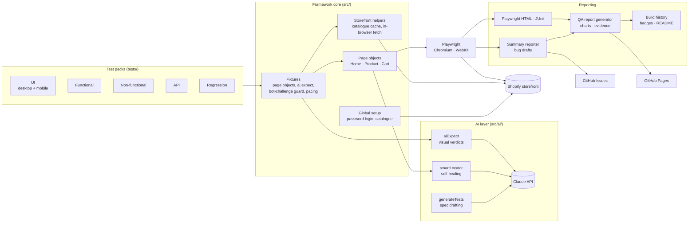
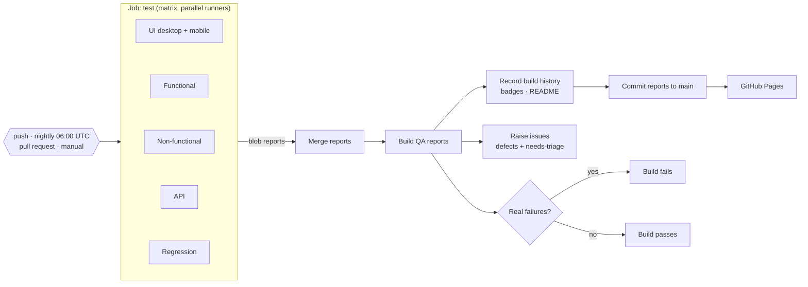

<h1 align="center">AI-Assisted Shopify Test Automation Framework</h1>

<p align="center">
An end-to-end quality engineering framework for a Shopify storefront: Playwright + TypeScript test packs,
Claude-powered visual checks, self-healing locators and test generation, a GitHub Actions CI/CD pipeline,
and QA reports, defects and build history published automatically for every build.
</p>

<p align="center">
  <a href="https://playwright.dev"></a>
  <a href="https://www.typescriptlang.org"></a>
  <a href="#ai-in-this-framework"></a>
  <a href="#test-strategy"></a>
  <a href="#test-strategy"></a>
  <a href="#cicd-pipeline"></a>
  <a href="https://github.com/jfix1974QA/shopify-automation/actions"></a>
</p>

<p align="center">
  <a href="https://github.com/jfix1974QA/shopify-automation/actions/workflows/storefront-tests.yml"></a>
  
  
  
  
</p>

<p align="center">
  <b><a href="https://jfix1974qa.github.io/shopify-automation/">Live QA reports</a></b> ·
  <a href="https://jfix1974qa.github.io/shopify-automation/qa-reports/build-history.html">Build history</a> ·
  <a href="https://github.com/jfix1974QA/shopify-automation/issues?q=label%3Abug">Defects raised</a> ·
  <a href="https://github.com/jfix1974QA/shopify-automation/actions">CI runs</a> ·
  <a href="docs/test-strategy.md">Test strategy</a>
</p>

---

## Contents

- [About the project](#about-the-project)
- [Architecture](#architecture)
- [AI in this framework](#ai-in-this-framework)
- [CI/CD pipeline](#cicd-pipeline)
- [Build results](#build-results)
- [Test strategy](#test-strategy)
- [Metrics](#metrics)
- [Getting started](#getting-started)
- [Project structure](#project-structure)

---

## About the project

This project is a production-style test automation framework built against a real Shopify store
(**[james-qa-shop.myshopify.com](https://james-qa-shop.myshopify.com)**, password protected; access on request).
It shows the full quality engineering lifecycle: test design, automation, execution in CI, defect management and reporting.

**What it does**

- **77 automated test cases in 5 packs**: UI (desktop and iPhone), Functional, Non-functional (performance, accessibility, SEO, security), API and Regression, including **37 edge and negative cases**.
- **AI-assisted testing with Claude**: plain-English visual assertions, product copy review, self-healing locators, and a generator that drafts new Playwright specs from a live page.
- **CI/CD with GitHub Actions**: every push, nightly schedule or manual run executes each pack on its own runner in parallel, merges the results, publishes reports and raises defects as GitHub issues.
- **QA deliverables for every build**: an execution report with coverage, test scripts with steps and actual results, a defect and QA summary with evidence and recommendations, and a build-by-build history. Published to **[GitHub Pages](https://jfix1974qa.github.io/shopify-automation/)**.
- **6 real defects found and raised** to a professional standard: severity, steps to reproduce, expected vs actual, evidence, root cause, recommendation and closure criteria ([issues #31–#36](https://github.com/jfix1974QA/shopify-automation/issues?q=label%3Abug)).

**Tech stack**

| Area | Tools |
|---|---|
| Test framework | Playwright 1.65 (Chromium, WebKit), TypeScript (strict) |
| AI | Claude API (`claude-opus-5-5`) via the official Anthropic SDK, structured outputs with Zod |
| Accessibility | axe-core (WCAG 2.0/2.1 A + AA) |
| CI/CD | GitHub Actions (matrix per pack, blob report merge), GitHub Pages, GitHub Issues |
| Reporting | Playwright HTML + JUnit, custom summary reporter, custom QA report generator with SVG charts |

---

## Architecture



**How a test run flows**

1. **Global setup** logs in through the storefront password page once, then caches the product catalogue (`.ai-cache/catalog.json`), so tests read real products without extra traffic.
2. **Fixtures** give every test page objects, a Claude-backed `ai.expect`, a guard that waits out (and never solves) bot-protection challenges, and pacing between tests.
3. **Page objects** find elements through `smartLocator`: known selectors first, then Claude as a fallback when a theme change breaks them.
4. **Reporters** produce the Playwright HTML report (trace and screenshot for every test), JUnit, and a summary that drafts a bug report for every failure.
5. **The QA report generator** combines the run with the requirements map (`qa/requirements.json`) and triaged defects (`qa/defects.json`) to produce the three QA reports, charts and evidence.
6. **Build history** records the build, refreshes the badges and the [Build results](#build-results) section of this README, and publishes the portfolio page.

More detail: [docs/architecture.md](docs/architecture.md).

---

## AI in this framework

Claude is used where scripted assertions are weak: judging what a page *looks like*, whether copy is *fit to publish*,
finding an element after a *theme change*, and drafting *new tests*. Every AI call returns **structured, schema-validated
JSON** (Zod), is attached to the report as evidence, and feeds a human triage step before anything becomes a defect.
The examples below are real outputs from this project.

### 1. Plain-English visual assertions: found DEF-003

```ts
// tests/ui/ai-visual.spec.ts
await home.open();
await ai.expect(
  'The page looks like a professional online store: a header with logo and navigation, ' +
  'a clear hero or featured section, no broken images, no overlapping or cut-off text, ' +
  'and no leftover placeholder or template copy.',
);
```

Claude's verdict in [CI build #3](https://github.com/jfix1974QA/shopify-automation/actions/runs/42829629022) (desktop):

> The visible header and hero look clean and professional, with no broken images or overlapping text. However, the
> element list shows leftover dev-store template content: a footer heading '© 2023 / Shopify, Inc.' and Shopify
> developer links ('Generated test data docs', 'GraphiQL API explorer')…
>
> **Issues:** Hero subtitle 'A Test Store to facilitate AI Assisted Test Automation' reads as internal test copy rather
> than customer-facing marketing; Footer 'Resources' block links to developer tools…

A selector-based test would pass this page: every element exists. Claude caught that the content isn't launch-ready.
That became **[DEF-003](https://github.com/jfix1974QA/shopify-automation/issues/33)**. The same check runs on an iPhone 14 viewport.

### 2. AI copy review: found DEF-002

```ts
// tests/ui/ai-visual.spec.ts (abridged)
const review = await askStructured({
  system: 'You are an e-commerce copy editor. Flag only real problems a customer would notice…',
  schema: z.object({ problems: z.array(z.object({ handle: z.string(), problem: z.string(), severity: z.enum(['high', 'low']) })) }),
  prompt: JSON.stringify(products),
});
```

Real output (CI build #3): 9 of the 10 products reviewed were flagged `high`, for example
`the-collection-snowboard-liquid: Product description is empty.` That became
**[DEF-002](https://github.com/jfix1974QA/shopify-automation/issues/32)**.

### 3. AI test generation: 7 new tests, 7 passing

```bash
npm run generate -- /collections/all "sorting by price and the product count"
```

The generator opens the live page, captures a screenshot and its interactive elements, and asks Claude to draft a spec
that uses this framework's own fixtures. Claude wrote
[`tests/generated/collections-all.spec.ts`](tests/generated/collections-all.spec.ts) with 7 tests: product count,
both price sort orders, sort persistence, an invalid `sort_by` value and an empty filter state. An excerpt:

```ts
test('choosing "Price, low to high" reorders the grid cheapest first', async ({ page, request }) => {
  const { prices } = await loadCatalogue(request);
  await page.goto(COLLECTION);
  const countBefore = await readProductCount(page);

  await sortSelect(page).selectOption('price-ascending');

  await expect(page).toHaveURL(/[?&]sort_by=price-ascending/);
  await expect(sortSelect(page)).toHaveValue('price-ascending');
  await expect
    .poll(async () => orderingProblem(await gridHandles(page), prices, 'asc'), {
      message: 'grid should be ordered by ascending price',
      timeout: 15_000,
    })
    .toBeNull();

  expect(await readProductCount(page)).toBe(countBefore);
});
```

**Human in the loop:** `tsc` flagged one type error (the draft passed an argument to a helper that takes none). After a
one-line reviewer fix, **all 7 generated tests passed against the live store on the first run** (58.9s).

### 4. Self-healing locators that refuse to guess

```ts
// src/pages/ProductPage.ts
quantityInput() {
  return this.find('quantity input on product page', ['input[name="quantity"]', 'input.quantity__input']);
}
```

When no known selector matches, `smartLocator` sends Claude a compact list of the page's elements and asks for one
robust selector. Real response from a run where the theme had no quantity box:

> *AI could not locate "quantity input on product page": The product form holds only hidden inputs (form_type, utf8,
> id, product-id, section-id) and the Add to cart and Buy it now buttons. No quantity input or quantity picker appears
> anywhere in the listed elements, so the theme seems to have removed it.*

Claude correctly reported the element as **absent** instead of inventing a selector that would make the test pass
falsely. That diagnosis led to the finding that the theme's quantity selector is switched off (logged as an observation).
Successful heals are cached in `.ai-cache/` and print the selector to copy back into the page object.

### Guardrails

| Guardrail | How |
|---|---|
| Structured output | Every call uses `messages.parse` with a Zod schema; malformed or refused responses fail loudly |
| Confidence threshold | `aiExpect` fails unless Claude reports `pass` with confidence ≥ 0.6 |
| Evidence | Screenshot and full verdict attached to the Playwright report for every AI check |
| Human triage | AI failures become bug *drafts*; only triaged issues enter `qa/defects.json` and GitHub Issues |
| Opt-in | Without `ANTHROPIC_API_KEY`, `@ai` tests skip and self-healing is off; everything else runs |
| Cost | About 4 visual calls per browser per run; self-healing calls Claude only when a selector breaks |

---

## CI/CD pipeline



| Stage | What happens |
|---|---|
| Triggers | Push to `main`, pull requests, nightly at 06:00 UTC, and manual runs (choose packs, toggle issue filing) |
| Test | Each pack runs on its own Ubuntu runner (Chromium; WebKit for mobile UI) after `npm ci` and a type-check |
| Merge | Blob reports from all runners merge into one HTML report, JUnit file and summary |
| Report | QA reports and build history are generated, uploaded as the `test-report` artifact (30 days) and committed to `main` (`[skip ci]`) |
| Publish | GitHub Pages serves the reports; the README badges and [Build results](#build-results) update automatically |
| Defects | Confirmed defects from `qa/defects.json` are raised as issues with full detail; new unlinked failures are raised as `needs-triage`; bot-protection blocks are never raised |
| Gate | The build fails on any real failure; tests blocked by bot protection are reported as warnings |

**Secrets:** `STORE_PASSWORD` and `ANTHROPIC_API_KEY` (repository secrets), `STORE_URL` (variable).
Workflow: [`.github/workflows/storefront-tests.yml`](.github/workflows/storefront-tests.yml).

---

## Build results

Updated automatically by CI after every build.

<!-- BUILDS:START -->


| Build | Date | Commit | Trigger | Executions | ✅ Passed | ❌ Failed | 🚧 Blocked | ⏭️ Skipped | Pass rate | Open defects | Time | Status |
|---|---|---|---|---:|---:|---:|---:|---:|---:|---:|---:|---|
| [#7](https://github.com/jfix1974QA/shopify-automation/actions/runs/43381935024) | 2026-11-13 06:54 UTC | [`82200f0`](https://github.com/jfix1974QA/shopify-automation/commit/82200f0) | schedule | 89 | 50 | 6 | 26 | 7 | 89.3% | 6 | 4m 20s | ❌ Failing |
| [#6](https://github.com/jfix1974QA/shopify-automation/actions/runs/43171562542) | 2026-11-12 06:55 UTC | [`78d2e56`](https://github.com/jfix1974QA/shopify-automation/commit/78d2e56) | schedule | 89 | 53 | 5 | 24 | 7 | 91.4% | 6 | 4m 9s | ❌ Failing |
| [#5](https://github.com/jfix1974QA/shopify-automation/actions/runs/42975692104) | 2026-11-11 06:54 UTC | [`f2e9fbd`](https://github.com/jfix1974QA/shopify-automation/commit/f2e9fbd) | schedule | 89 | 51 | 4 | 27 | 7 | 92.7% | 6 | 4m 14s | ❌ Failing |
| [#4](https://github.com/jfix1974QA/shopify-automation/actions/runs/42882386969) | 2026-11-10 19:09 UTC | [`e6a951e`](https://github.com/jfix1974QA/shopify-automation/commit/e6a951e) | push | 89 | 50 | 5 | 27 | 7 | 90.9% | 6 | 4m 23s | ❌ Failing |
| [#3](https://github.com/jfix1974QA/shopify-automation/actions/runs/42829629022) | 2026-11-10 13:59 UTC | [`3a17b31`](https://github.com/jfix1974QA/shopify-automation/commit/3a17b31) | push | 89 | 49 | 6 | 27 | 7 | 89.1% | 6 | 6m 15s | ❌ Failing |
| [#2](https://github.com/jfix1974QA/shopify-automation/actions/runs/42827257169) | 2026-11-10 13:44 UTC | [`6b424bc`](https://github.com/jfix1974QA/shopify-automation/commit/6b424bc) | workflow_dispatch | 89 | 53 | 5 | 24 | 7 | 91.4% | 6 | 12m 48s | ❌ Failing |
| [#1](https://github.com/jfix1974QA/shopify-automation/actions/runs/42822779517) | 2026-11-10 13:14 UTC | [`2eaea0b`](https://github.com/jfix1974QA/shopify-automation/commit/2eaea0b) | push | 89 | 52 | 7 | 23 | 7 | 88.1% | 6 | 21m 25s | ❌ Failing |

[Full build history →](qa-reports/build-history.md)
<!-- BUILDS:END -->

**Reading the results:** *Blocked* tests were stopped by Shopify's bot protection (a Cloudflare challenge on shared CI
runner IPs) before they could check anything. They are reported separately, excluded from the pass rate and never
raised as defects. *Failed* tests are real findings, each linked to a defect.

---

## Test strategy

Full document: **[docs/test-strategy.md](docs/test-strategy.md)**.

**Objective:** give fast, trustworthy evidence that a shopper can find, choose and buy products, and that the store
meets accessibility, performance, SEO and security expectations, with every defect reported to a standard a developer
can act on without follow-up questions.

| Pack | Type | Test cases | Focus |
|---|---|---:|---|
| UI | UI / visual | 12 × 2 browsers | Layout, rendering, responsive design, keyboard access, Claude visual review |
| Functional | Functional | 28 | Product, cart, checkout hand-off, search, sorting, forms, edge cases |
| Non-functional | Performance, accessibility, SEO, security | 15 | Load budgets, WCAG 2.1 AA, meta tags, HTTPS, headers, cookies, slow and offline networks |
| API | API | 17 | Storefront Ajax API: products, cart CRUD, search, error handling, contract |
| Regression | End-to-end + visual | 5 (+ 15 tagged) | Critical journeys and screenshot baselines |

**In scope**

- Storefront UI on desktop Chrome and iPhone 14 (WebKit)
- Shopper journeys from browsing to the Shopify checkout page
- Storefront Ajax API (products, cart, predictive search)
- Performance budgets, automated accessibility (WCAG 2.1 AA), SEO tags, security headers and cookies
- Content quality through Claude visual and copy review
- Visual regression of home, product and empty-cart pages
- Edge and negative cases: quantity limits, invalid input, URL tampering, XSS-style search input, offline and slow networks

**Out of scope**

- Payment and order placement (tests stop at Shopify checkout; no payment details are ever entered)
- Shopify admin and back-office workflows
- Customer accounts (hosted by Shopify)
- Load and stress testing
- Manual exploratory and usability testing
- Browsers other than Chromium and WebKit

**Approach:** risk-based prioritisation (P1 high, P2 medium, P3 low); real catalogue data instead of hard-coded
products; edge cases tagged `@edge`; AI only where selectors cannot judge quality. **Exit criteria** are the quality
gates in the [Defect & QA summary](https://jfix1974qa.github.io/shopify-automation/qa-reports/3-defect-and-qa-summary.html):
pass rate ≥ 95%, all P1 tests pass, no open Critical or High defects, no serious accessibility violations, performance
budgets met, security checks pass, no flaky tests.

---

## Metrics

<!-- METRICS:START -->
_Latest build [#7](https://github.com/jfix1974QA/shopify-automation/actions/runs/43381935024) · 2026-11-13 06:54 UTC · commit `82200f0` · updated automatically by CI_

| Metric | Value |
|---|---|
| Test cases | **77** (89 executions across desktop and mobile) |
| Passed / Failed / Blocked / Skipped | **50** / **6** / **26** / **7** |
| Pass rate (verified tests) | **89.3%** |
| Requirements covered | **23/23** |
| Open defects | **6** (Critical 0 · High 0 · Medium 4 · Low 2) |
| CI build time | **4m 20s** (whole pipeline; packs run in parallel) |

| Pack | Passed | Failed | Blocked | Skipped |
|---|---:|---:|---:|---:|
| ui | 9 | 2 | 0 | 1 |
| ui-mobile | 9 | 1 | 0 | 2 |
| functional | 14 | 0 | 10 | 4 |
| non-functional | 12 | 3 | 0 | 0 |
| api | 1 | 0 | 16 | 0 |
| regression | 5 | 0 | 0 | 0 |
<!-- METRICS:END -->

**Test inventory**

| Metric | Value |
|---|---|
| Automated test cases | 77 (89 executions per build: UI runs on desktop and mobile) |
| Test packs | 5 (UI, Functional, Non-functional, API, Regression) |
| Edge / negative cases | 37 (`npm run test:edge`) |
| Claude-powered checks | 4 visual and copy checks, plus self-healing and test generation |
| AI-generated tests | 7 drafted, 7 passing after review |
| Requirements traced | 23 store features, each mapped to tests ([traceability](qa-reports/1-automation-execution-report.md#test-coverage)) |
| Browsers | Chromium (desktop), WebKit (iPhone 14) |

**Defects raised** ([full summary](https://jfix1974qa.github.io/shopify-automation/qa-reports/3-defect-and-qa-summary.html))

| ID | Defect | Severity | Area |
|---|---|---|---|
| [DEF-001](https://github.com/jfix1974QA/shopify-automation/issues/31) | "Sale" badge text fails WCAG 2.1 AA contrast (2.22:1, needs 4.5:1) | Medium | Accessibility |
| [DEF-002](https://github.com/jfix1974QA/shopify-automation/issues/32) | Most products have an empty description (9 of 10 reviewed) | Medium | Content |
| [DEF-003](https://github.com/jfix1974QA/shopify-automation/issues/33) | Home page and footer show test copy and sample-store content | Medium | Content |
| [DEF-004](https://github.com/jfix1974QA/shopify-automation/issues/34) | Meta description missing on home, collection and product pages | Medium | SEO |
| [DEF-005](https://github.com/jfix1974QA/shopify-automation/issues/35) | No social sharing image (og:image) on home and collection pages | Low | SEO |
| [DEF-006](https://github.com/jfix1974QA/shopify-automation/issues/36) | `cart` cookie issued without the Secure attribute | Low | Security |

**Reports**

| Report | Markdown | Web |
|---|---|---|
| Automation execution report (statistics, coverage) | [view](qa-reports/1-automation-execution-report.md) | [open](https://jfix1974qa.github.io/shopify-automation/qa-reports/1-automation-execution-report.html) |
| Test scripts and scenarios (steps, expected, actual) | [view](qa-reports/2-test-scripts-and-scenarios.md) | [open](https://jfix1974qa.github.io/shopify-automation/qa-reports/2-test-scripts-and-scenarios.html) |
| Defect and QA summary (severity, evidence, recommendations) | [view](qa-reports/3-defect-and-qa-summary.md) | [open](https://jfix1974qa.github.io/shopify-automation/qa-reports/3-defect-and-qa-summary.html) |
| Build history (every CI build) | [view](qa-reports/build-history.md) | [open](https://jfix1974qa.github.io/shopify-automation/qa-reports/build-history.html) |

---

## Getting started

```bash
git clone https://github.com/jfix1974QA/shopify-automation.git
cd shopify-automation
npm install
npx playwright install chromium webkit
cp .env.example .env     # then set STORE_URL, STORE_PASSWORD and (optionally) ANTHROPIC_API_KEY
```

| Command | What it runs |
|---|---|
| `npm test` | All packs |
| `npm run test:ui` · `test:functional` · `test:non-functional` · `test:api` | One pack |
| `npm run test:regression` | Regression pack plus every `@regression` test |
| `npm run test:smoke` | High-priority (`@P1`) tests |
| `npm run test:edge` | Edge and negative cases |
| `npm run test:ai` · `test:no-ai` | Only / everything except Claude checks |
| `npm run generate -- <path> ["focus"]` | Draft a new spec with Claude into `tests/generated/` |
| `npm run qa-reports` | Build the QA reports from the latest run |
| `npm run report` | Open the interactive Playwright report |

Shopify rate-limits storefronts per IP. Locally the suite paces itself (2 workers, short pauses); if setup reports bot
protection, wait 15–30 minutes. CI spreads packs across runners.

---

## Project structure

```
.github/
  workflows/storefront-tests.yml   CI/CD pipeline
  ISSUE_TEMPLATE/                  defect report template
  pull_request_template.md
docs/
  architecture.md                  components, data flow, design decisions
  test-strategy.md                 scope, approach, entry/exit criteria, defect management
qa/
  requirements.json                23 store features mapped to tests (coverage)
  defects.json                     triaged defects, observations, recommendations
  build-history.json               every CI build's results (written by CI)
qa-reports/                        generated QA reports, charts, evidence, badges (published to Pages)
scripts/
  qa-report/                       report generator, charts, build history, evidence capture
  file-github-issues.mjs           raises defects and triage issues
  ci-summary.mjs                   CI job summary and pass/fail gate
src/
  ai/                              Claude client, aiExpect, self-healing, test generator
  pages/                           page objects (Home, Product, Cart)
  reporting/                       summary reporter and bug drafts
  utils/                           storefront helpers, page snapshot
  fixtures.ts · global-setup.ts · config.ts
tests/
  ui/ functional/ non-functional/ api/ regression/   test packs
  generated/                       Claude-drafted specs (reviewed before promotion)
playwright.config.ts · merge.config.ts · tsconfig.json
```

---

<p align="center">Built by <a href="https://github.com/jfix1974QA">James</a> · Playwright · TypeScript · Claude · GitHub Actions</p>
