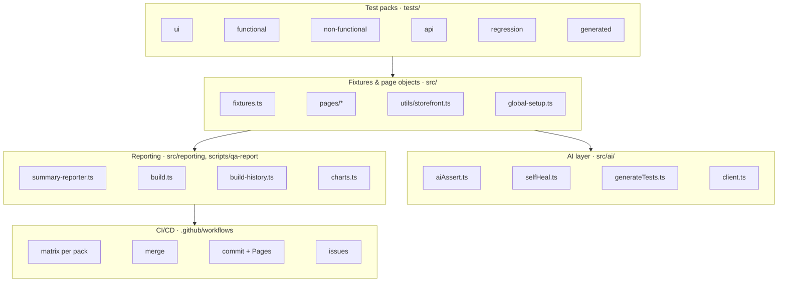

# Architecture

## Overview

The framework has five layers: **test packs** describe behaviour; **fixtures and page objects** give tests a stable API
over the storefront; the **AI layer** adds Claude where scripted checks are weak; **reporting** turns raw results into
QA deliverables; **CI/CD** runs everything and publishes the results.

## Components

| Component | File | Responsibility |
|---|---|---|
| Config | `src/config.ts` | Reads `.env`: store URL, password, AI key and model |
| Global setup | `src/global-setup.ts` | Logs in through the storefront password page once (retrying through bot checks), saves the session, caches the catalogue (falls back to `/collections/all` and a 24-hour cache) |
| Fixtures | `src/fixtures.ts` | Page objects, `ai.expect`, a `page.goto` wrapper and teardown hook that detect bot-protection challenges, and pacing between tests |
| Page objects | `src/pages/*.ts` | Home, Product and Cart with Dawn selectors plus fallbacks; ignore hidden duplicates (e.g. cart drawer) |
| Storefront helpers | `src/utils/storefront.ts` | Cached catalogue, product finders, in-browser `fetch` with a 15s timeout and a 40s retry budget for cart/API calls |
| AI client | `src/ai/client.ts` | Anthropic SDK; `askStructured` (Zod-validated JSON) and `askText` (streaming) |
| Visual assertions | `src/ai/aiAssert.ts` | Screenshot + element list → Claude verdict `{pass, confidence, reasoning, issues}`; attached to the report |
| Self-healing | `src/ai/selfHeal.ts` | Known selectors first; Claude fallback; caches heals in `.ai-cache/` |
| Test generator | `src/ai/generateTests.ts` | Captures a live page and drafts a spec that uses the framework's fixtures |
| Summary reporter | `src/reporting/summary-reporter.ts` | Per-test results, executed steps, evidence copies, bug drafts, `summary.json` |
| QA report generator | `scripts/qa-report/build.ts` | Three QA reports (Markdown + HTML), charts, evidence, quality gates; classifies bot-protection blocks |
| Build history | `scripts/qa-report/build-history.ts` | Records each build, writes the portfolio page and badges, refreshes README sections |
| Issue filing | `scripts/file-github-issues.mjs` | Raises confirmed defects and needs-triage issues; skips blocked tests and duplicates |

## Design decisions

| Decision | Why |
|---|---|
| Store requests run inside the browser (`page.evaluate(fetch)`) | Shopify's bot protection rejects plain HTTP clients but accepts the real browser session |
| One login and one catalogue read per run | Keeps traffic low enough to avoid per-IP rate limiting |
| *Blocked* is a separate status | A test stopped by a CAPTCHA says nothing about the store; counting it as failed would raise false defects |
| Claude must report "not found" rather than guess | A guessed selector can make a broken test pass; refusals are safer and diagnostic |
| Each pack is a Playwright project and a CI matrix job | Results group by pack, packs run in parallel on separate runners (separate IPs) |
| Reports generated as Markdown and HTML | Markdown renders on GitHub; HTML is richer and served by GitHub Pages |
| Defects curated in `qa/defects.json` | Auto-drafts are triaged; only confirmed defects become issues, with full detail |

## Data flow per CI build

1. Five runners execute their pack and upload blob reports.
2. The report job merges blobs into the HTML report, JUnit and `reports/summary.json`.
3. `npm run qa-reports` builds the QA reports; `build-history.ts` records the build and updates badges and the README.
4. The job commits `qa-reports/`, `qa/build-history.json` and `README.md` to `main` with `[skip ci]`; GitHub Pages redeploys.
5. `file-github-issues.mjs` raises defects and triage issues; `ci-summary.mjs` writes the job summary and fails the build on real failures.
