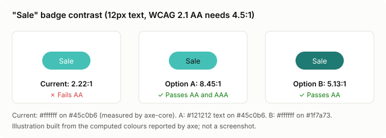
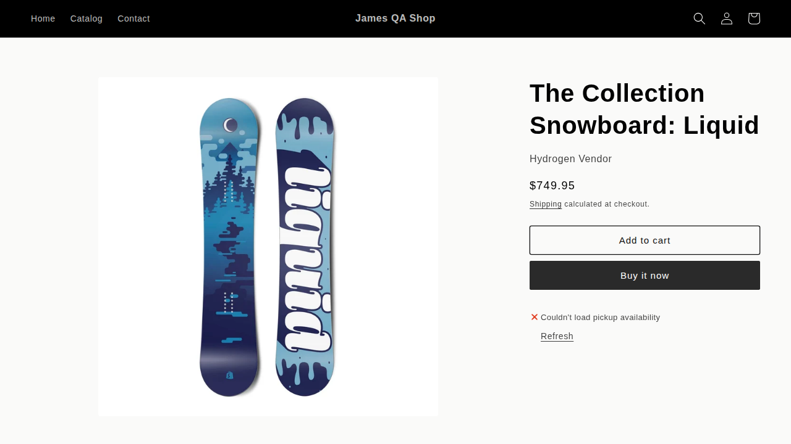
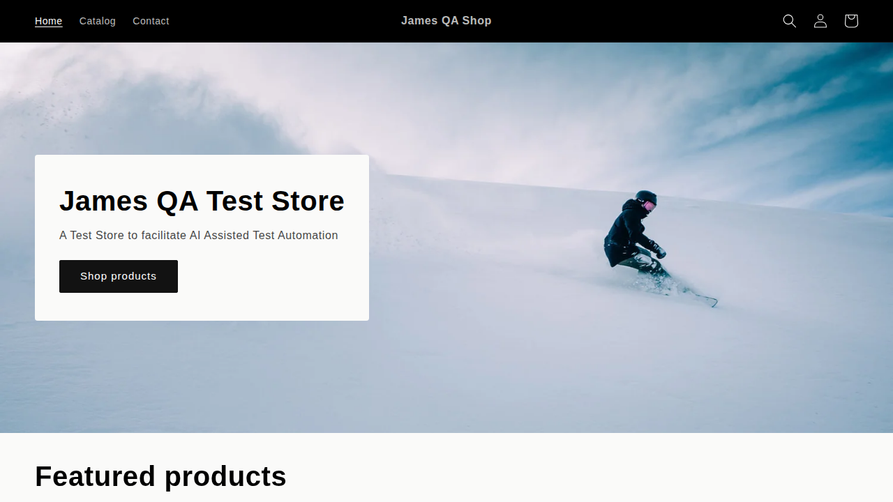
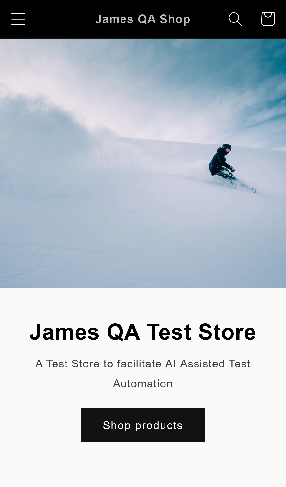

# 3. Defect and QA Summary

[Index](README.md) · [1. Execution report](1-automation-execution-report.md) · [2. Test scripts & scenarios](2-test-scripts-and-scenarios.md) · [3. Defect & QA summary](3-defect-and-qa-summary.md)

**Store:** https://james-qa-shop.myshopify.com · **Run:** 2026-11-10 14:00 UTC · **Defects raised:** 6 · **Quality gates met:** 3/8

## QA verdict: Not yet verified


| Quality gate | Actual | Status |
|---|---|---|
| Overall pass rate ≥ 95% | 89.1% | ❌ Not met |
| All P1 (high-priority) tests pass | 13/24 verified passing | ❌ Not met |
| All planned tests executed (none blocked) | 27 blocked | ❌ Not met |
| No open Critical or High defects | 0 open | ✅ Met |
| No serious/critical accessibility violations | Failed | ❌ Not met |
| Performance budgets met | 3/3 pages | ✅ Met |
| Security checks pass | 4/5 | ❌ Not met |
| No flaky tests | 0 | ✅ Met |

## Defects at a glance


| ID | Title | Severity | Priority | Area | Found by | Status |
|---|---|---|---|---|---|---|
| [DEF-001](#def-001) | "Sale" badge text fails WCAG 2.1 AA colour contrast (2.22:1, needs 4.5:1) | 🟡 Medium | P1 - fix before launch | Accessibility | NF-05 | Open |
| [DEF-002](#def-002) | Most products have an empty description (9 of the 10 reviewed) | 🟡 Medium | P2 | Content | UI-AI-04, NF-07 | Open |
| [DEF-003](#def-003) | Home page and footer show test copy and development-store sample content | 🟡 Medium | P2 - blocks go-live | Content | UI-AI-01 | Open |
| [DEF-004](#def-004) | Meta description missing on home, collection and product pages | 🟡 Medium | P3 | SEO | NF-07 | Open |
| [DEF-005](#def-005) | No social sharing image (og:image) on home and collection pages | ⚪ Low | P3 | SEO | NF-07 | Open |
| [DEF-006](#def-006) | "cart" cookie is issued without the Secure attribute | ⚪ Low | P3 | Security | NF-11 | Open |

Severity scale: **Critical** blocks purchasing or exposes data · **High** breaks a key journey or affects many users · **Medium** degrades a feature, workaround exists · **Low** cosmetic, SEO or minor.

---

### DEF-001

## "Sale" badge text fails WCAG 2.1 AA colour contrast (2.22:1, needs 4.5:1)

| Field | Value |
|---|---|
| Defect ID | DEF-001 |
| Severity | 🟡 Medium |
| Priority | P1 - fix before launch |
| Status | Open |
| Type | Accessibility (WCAG 2.1 SC 1.4.3) |
| Area | Accessibility |
| Found by | `NF-05` |
| Environment | james-qa-shop.myshopify.com, Dawn theme; Chromium (desktop) with axe-core 4.x; reproduced on home, /collections/all and product pages |
| Reported | 2026-11-10 14:00 UTC |

**Preconditions:** At least one product on sale (compare-at price set), e.g. The Collection Snowboard: Liquid.

**Steps to reproduce**
1. Open https://james-qa-shop.myshopify.com/collections/all (enter the storefront password if asked).
2. Find the product card for "The Collection Snowboard: Liquid", which shows a "Sale" badge.
3. Inspect the badge (span.badge.color-accent-2) and read its computed text and background colours, or run axe DevTools / Lighthouse accessibility audit on the page.

**Expected result:** Badge text (12px, normal weight) has a contrast ratio of at least 4.5:1 against its background (WCAG 2.1 AA, SC 1.4.3).

**Actual result:** White text #ffffff on teal #45c0b6 gives 2.22:1. axe reports a serious color-contrast violation on every page that shows a sale badge (home featured collection, collection grid, product page).

**Evidence**



*Sale badge contrast: current colours vs two compliant options (illustration from axe-measured colours)*


*axe-core output (NF-05)*

```
[serious] color-contrast: Elements must meet minimum color contrast ratio thresholds
  -> span.badge.badge--bottom-left.color-accent-2  "Sale"
  Element has insufficient color contrast of 2.21 (foreground color: #ffffff, background color: #45c0b6,
  font size: 9.0pt (12px), font weight: normal). Expected contrast ratio of 4.5:1
Pages: /, /collections/all, /products/the-collection-snowboard-liquid
```


**Impact:** Shoppers with low vision or colour-vision deficiency, or anyone on a phone in bright light, may not be able to read the Sale label, so they miss discounts. It is a WCAG 2.1 AA failure on every page with sale items, which creates compliance risk (ADA in the US, European Accessibility Act in force since June 2025).

**Root cause analysis:** The badge uses the theme's "Accent 2" colour scheme (class color-accent-2): white foreground on a light teal background. The scheme was not checked for contrast when it was chosen.

**Recommendation:** In the theme editor go to Theme settings > Colors and change the colour scheme used for sale badges (Theme settings > Badges > Sale badge color scheme) to one that passes. Two compliant options: keep the teal and switch the text to #121212 (8.45:1), or keep white text on a darker teal such as #1f7a73 (5.13:1). Check other places that use the same scheme. Keep NF-05 as a release gate so the issue cannot come back.

**Acceptance criteria for closure**
- [ ] Sale badge text contrast is at least 4.5:1 (verified with axe or a contrast checker).
- [ ] NF-05 passes with no serious or critical axe violations on home, collection, product and cart pages.
- [ ] Visual baseline REG-04 updated to the new badge colours after review.

**References:** https://www.w3.org/WAI/WCAG21/Understanding/contrast-minimum.html · https://dequeuniversity.com/rules/axe/4.10/color-contrast

---

### DEF-002

## Most products have an empty description (9 of the 10 reviewed)

| Field | Value |
|---|---|
| Defect ID | DEF-002 |
| Severity | 🟡 Medium |
| Priority | P2 |
| Status | Open |
| Type | Content / data quality |
| Area | Content |
| Found by | `UI-AI-04`, `NF-07` |
| Environment | james-qa-shop.myshopify.com catalogue (13 products) as served by the storefront on the test date |
| Reported | 2026-11-10 14:00 UTC |

**Steps to reproduce**
1. Open https://james-qa-shop.myshopify.com/products/the-collection-snowboard-liquid.
2. Look below the price and Add to cart button for the product description.
3. Repeat for the other affected products listed in the evidence.

**Expected result:** Every product has a customer-facing description explaining what it is, its key features and specifications.

**Actual result:** Claude's copy review (UI-AI-04) checked the first 10 products in the catalogue and found the description empty on 9: the-collection-snowboard-liquid, the-collection-snowboard-oxygen, the-collection-snowboard-hydrogen, the-multi-location-snowboard, the-multi-managed-snowboard, the-3p-fulfilled-snowboard, selling-plans-ski-wax, the-videographer-snowboard, the-compare-at-price-snowboard. The product page shows no description at all.

**Evidence**



*Product page for The Collection Snowboard: Liquid during test FN-01: no description between the buy buttons and pickup info*


*Claude copy review (UI-AI-04, CI build #3), high-severity findings*

```
the-collection-snowboard-liquid: Product description is empty.
the-collection-snowboard-oxygen: Product description is empty.
the-collection-snowboard-hydrogen: Product description is empty.
the-multi-location-snowboard: Product description is empty.
the-multi-managed-snowboard: Product description is empty.
the-3p-fulfilled-snowboard: Product description is empty.
selling-plans-ski-wax: Product description is empty.
the-videographer-snowboard: Product description is empty.
the-compare-at-price-snowboard: Product description is empty.
```


**Impact:** Shoppers cannot see what they are buying, which lowers conversion and raises returns and support questions. Search engines get no product text, and the product page has no meta description because Shopify builds it from the description (see DEF-004). Several affected products are among the most expensive ($749.95 to $2,629.95).

**Root cause analysis:** These products came from Shopify's development-store sample data generator, which creates products without descriptions. No content review was done before testing.

**Recommendation:** Write a description for each affected product (aim for at least 50 words, including key features, materials and sizing). Add a content-readiness check to the launch checklist, and keep UI-AI-04 in the regression suite so new products without descriptions are caught automatically.

**Acceptance criteria for closure**
- [ ] Every product has a non-empty, customer-facing description.
- [ ] UI-AI-04 passes with no high-severity findings.
- [ ] Each product page renders a meta description (NF-07).

---

### DEF-003

## Home page and footer show test copy and development-store sample content

| Field | Value |
|---|---|
| Defect ID | DEF-003 |
| Severity | 🟡 Medium |
| Priority | P2 - blocks go-live |
| Status | Open |
| Type | Content / launch readiness |
| Area | Content |
| Found by | `UI-AI-01` |
| Environment | james-qa-shop.myshopify.com home page; desktop Chrome and iPhone 14 (WebKit) |
| Reported | 2026-11-10 14:00 UTC |

**Steps to reproduce**
1. Open https://james-qa-shop.myshopify.com/.
2. Read the hero banner text.
3. Scroll to the image-with-text section and to the footer.

**Expected result:** All visible copy is final, customer-facing content. No internal, test or platform-generated text or links.

**Actual result:** The hero says "James QA Test Store" / "A Test Store to facilitate AI Assisted Test Automation". The footer has a "Resources" menu linking to "Generated test data docs" and "GraphiQL API explorer", and uses "© 2023 / Shopify, Inc." as a heading. The image-with-text section has the heading "Stay hydrated" on a ski wax promotion ("Get waxy now"). Claude flagged this on both desktop and mobile.

**Evidence**



*Home page hero during UI-AI-01 (desktop): "A Test Store to facilitate AI Assisted Test Automation"*




*Home page during UI-AI-01 (iPhone 14)*


*Claude visual review (UI-AI-01, desktop)*

```
Hero subheading reads 'A Test Store to facilitate AI Assisted Test Automation', which is test/internal copy.
Footer contains leftover generated-store content: 'Generated test data docs' and 'GraphiQL API explorer' links, and '© 2023 / Shopify, Inc.' used as a footer heading.
The image-with-text section uses a mismatched heading, 'Stay hydrated', for a ski wax CTA ('Get waxy now').
```


**Impact:** On a live store this would look unfinished and untrustworthy, and the footer links send shoppers to developer tools. It is intentional for a QA store, but it must be fixed before launch. Raised so it is tracked as a go-live blocker.

**Root cause analysis:** Store content still comes from the development-store setup (hero text written for testing, sample-data footer menu, theme default section copy).

**Recommendation:** Before launch: rewrite the hero heading and subheading; delete the "Resources" footer menu (Online Store > Navigation) or replace it with customer links (Shipping, Returns, Contact); replace the footer heading with the brand name and current year; correct the "Stay hydrated" heading. Keep UI-AI-01 as a release gate.

**Acceptance criteria for closure**
- [ ] No test, sample or developer text or links anywhere on the home page or footer.
- [ ] UI-AI-01 passes on desktop and mobile.
- [ ] Visual baseline REG-03 updated after content sign-off.

---

### DEF-004

## Meta description missing on home, collection and product pages

| Field | Value |
|---|---|
| Defect ID | DEF-004 |
| Severity | 🟡 Medium |
| Priority | P3 |
| Status | Open |
| Type | SEO / configuration |
| Area | SEO |
| Found by | `NF-07` |
| Environment | james-qa-shop.myshopify.com; page HTML <head> on the test date |
| Reported | 2026-11-10 14:00 UTC |

**Steps to reproduce**
1. Open https://james-qa-shop.myshopify.com/ and view the page source (Ctrl+U).
2. Search the <head> for <meta name="description">.
3. Repeat for /collections/all and /products/the-collection-snowboard-liquid.

**Expected result:** Each key page has a unique meta description of roughly 50-160 characters that summarises the page for search results.

**Actual result:** No <meta name="description"> tag is output on the home page, the collection page or the product page tested.

**Evidence**

*NF-07 assertion output*

```
/: meta description -> element(s) not found
/collections/all: meta description -> element(s) not found
/products/the-collection-snowboard-liquid: meta description -> element(s) not found
```


**Impact:** Search engines generate their own snippet, often from navigation or random page text, which lowers click-through from search results. It affects every page type tested.

**Root cause analysis:** The homepage meta description is blank (Online Store > Preferences). The collection and product have no SEO description, and Dawn only outputs the tag when page_description has a value. For products this falls back to the description, which is empty (DEF-002).

**Recommendation:** Set a homepage meta description in Online Store > Preferences. Add SEO descriptions in the "Search engine listing" section of each collection and product. Fixing DEF-002 also gives products a fallback description.

**Acceptance criteria for closure**
- [ ] Home, collection and product pages each output a meta description of 50-160 characters.
- [ ] NF-07 meta description checks pass.

**References:** https://help.shopify.com/en/manual/promoting-marketing/seo/adding-keywords

---

### DEF-005

## No social sharing image (og:image) on home and collection pages

| Field | Value |
|---|---|
| Defect ID | DEF-005 |
| Severity | ⚪ Low |
| Priority | P3 |
| Status | Open |
| Type | SEO / configuration |
| Area | SEO |
| Found by | `NF-07` |
| Environment | james-qa-shop.myshopify.com; page HTML <head> on the test date |
| Reported | 2026-11-10 14:00 UTC |

**Steps to reproduce**
1. Open https://james-qa-shop.myshopify.com/ and view the page source.
2. Search the <head> for <meta property="og:image">.
3. Repeat for /collections/all.

**Expected result:** Home and collection pages output an og:image so links shared on social media and messaging apps show a preview image.

**Actual result:** No og:image tag on the home page or /collections/all. (Product pages do have one, taken from the product image.)

**Evidence**

*NF-07 assertion output*

```
/: og:image -> element(s) not found
/collections/all: og:image -> element(s) not found
```


**Impact:** Links to the store shared on Facebook, LinkedIn, WhatsApp, Slack and similar show no image, which makes them less likely to be clicked.

**Root cause analysis:** No social sharing image is set in Online Store > Preferences, and the collection has no image.

**Recommendation:** Upload a social sharing image (1200 x 628 px recommended) in Online Store > Preferences, and add collection images. Check the preview with a link-preview tool.

**Acceptance criteria for closure**
- [ ] Home and collection pages output og:image with a valid image URL.
- [ ] NF-07 og:image checks pass.

---

### DEF-006

## "cart" cookie is issued without the Secure attribute

| Field | Value |
|---|---|
| Defect ID | DEF-006 |
| Severity | ⚪ Low |
| Priority | P3 |
| Status | Open |
| Type | Security / cookie configuration |
| Area | Security |
| Found by | `NF-11` |
| Environment | james-qa-shop.myshopify.com; Chromium; cookie set after adding an item to the cart |
| Reported | 2026-11-10 14:00 UTC |

**Steps to reproduce**
1. Open https://james-qa-shop.myshopify.com/ in Chrome and open DevTools > Application > Cookies.
2. Add any in-stock product to the cart.
3. Select the "cart" cookie and check the Secure column.

**Expected result:** Cookies that identify a shopper's cart or session are set with the Secure attribute, so browsers only send them over HTTPS.

**Actual result:** The "cart" cookie (the cart token) has Secure = false. Other session cookies (e.g. _shopify_essential) are Secure.

**Evidence**

*NF-11 assertion output (cookie names only; values are never recorded)*

```
Session/cart cookies without Secure flag: cart
Checked after adding an item to the cart. _shopify_essential and other session cookies were Secure.
```


**Impact:** Low in practice: the store sends HSTS and redirects HTTP to HTTPS (NF-09 and NF-10 pass), so the cookie is unlikely to travel over plain HTTP. Without Secure, though, a cart token could leak on a first-visit HTTP request or on a misconfigured network, letting someone view or change that cart. Security scanners and PCI-style reviews flag this.

**Root cause analysis:** The cart cookie is set by Shopify's storefront cart code without the Secure attribute. It is not set by the theme (to confirm: search the theme's assets for document.cookie).

**Recommendation:** Confirm the theme does not write the cart cookie. If it does, add "; Secure; SameSite=Lax". If it doesn't, raise it with Shopify Support as a platform hardening request. Make sure HSTS covers the custom domain once one is connected.

**Acceptance criteria for closure**
- [ ] The cart cookie has the Secure attribute, or Shopify confirms it is platform-managed and the risk is accepted and documented.
- [ ] NF-11 passes, or is updated to reflect the accepted risk.

---

## Observations (not defects)

- **No quantity selector on product pages.** The theme's product information section has the quantity selector turned off, so shoppers can only add one at a time and change quantity in the cart. FN-03, FN-15, FN-16 and FN-17 are skipped for this reason; quantity rules are still tested through the cart API (API-10, API-12, API-13). Recommendation: enable "Quantity selector" in the theme editor (Product information block) if multi-unit purchases are expected.
- **Contact form has no inline validation for a missing email.** The email field is marked with * and aria-required but has no native required attribute, so the browser does not stop an empty submission, and the request is gated by Shopify's hCaptcha. The empty form was not accepted, but no message told the user why. Recommendation: add the required attribute to the email field in the contact form section so the browser shows a message straight away.
- **Preference cookies without Secure flag.** localization and cart_currency are set without Secure. They hold country and currency preferences, not identity, so they are not raised as a defect.
- **Shopify bot protection limits automated runs from one IP.** Shopify's bot protection (Cloudflare) limits automated traffic. From this PC it showed a 'Verifying your connection' check (HTTP 429) after about 15 minutes of continuous testing. On GitHub Actions runners (shared data-centre IPs) it sometimes showed an interactive 'Verify you are human' CAPTCHA, which automation must not and does not attempt to solve. The framework waits for automatic checks to clear and otherwise reports the test as Blocked (not Failed, never a defect). The API and cart tests are the most affected because they call the storefront Ajax endpoints directly.
- **Visual baselines recorded in this run.** REG-03 to REG-05 recorded their first screenshots in this run, so they pass by definition. From the next run on they compare against these baselines. Re-approve them after DEF-001 and DEF-003 are fixed.

## Recommendations

1. Fix DEF-001 (Sale badge contrast) before launch. It is quick to fix and removes an accessibility compliance risk.
2. Do a content-readiness pass (DEF-002, DEF-003): product descriptions, hero copy, footer menu. Make UI-AI-01 and UI-AI-04 release gates.
3. Complete SEO set-up (DEF-004, DEF-005): homepage meta description, social sharing image, collection and product SEO fields.
4. Raise DEF-006 with Shopify Support if the theme is not setting the cart cookie, and record the decision.
5. Run the suite in GitHub Actions on every push and nightly (workflow included). To stop bot protection blocking the API and cart tests: (a) move the API pack to the official Storefront API (GraphQL) using a Storefront access token from a headless channel, which is rate-limited by token rather than bot protection; or (b) run CI on a self-hosted runner on a trusted network.
6. Commit the Linux visual baselines from the first CI run, and re-approve REG-03/REG-04 after the content and colour fixes.
7. Enable the product-page quantity selector if multi-unit orders matter, which re-enables FN-03 and FN-15 to FN-17.
8. Treat every new failure as a bug draft (reports/bugs) and triage it within one working day: confirm it as a defect, fix the test, or log it as an environment issue.

## Scope

**In scope:** Storefront UI on desktop Chrome and iPhone 14 (WebKit); Shopping journeys up to the Shopify checkout page; Storefront Ajax API (products, cart, predictive search); Performance budgets, accessibility (WCAG 2.1 AA, automated), SEO tags, security headers and cookies; Content quality via Claude visual and copy review; Visual regression of home, product and empty cart.

**Out of scope:** Payment and order placement (Shopify checkout is not modified; tests stop at checkout); Shopify admin and back-office workflows; Customer accounts (new customer accounts are hosted by Shopify); Manual exploratory and usability testing; Load and stress testing; Browsers other than Chromium and WebKit (e.g. Firefox).
